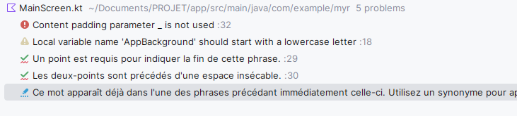

# MyR : application de recettes


> TODO : faire une description pour expliquer rapidement le concept
> 
> TODO : faire une liste des frameworks & choix d'implémentation (A FAIRE AU FUR ET A MESURE)


> TODO : il faudra faire la liste des dossiers dans le dossier de ce que j'ai appris

## TODO: 
- [ ] On peut faire un système ou on génère un PDF (comme la visu avec le VisuRecette)
- [ ] Faire un dossier composable, où l'on met tous les composables dans le même dossier


## `error.md`


## `librairies.md`
### Ajouter jetpack à un projet


## `kotlin.md`


## `jetpack.md`
```kotlin
@Composable
fun StepRow(instructions: String, bulletColor: Color) {
    val texteAvecRond = buildAnnotatedString {
        appendInlineContent(id = "mon_rond")
        append("  ")
        append(instructions)
    }

    val composantsIntegres = mapOf(
        "mon_rond" to InlineTextContent(
            Placeholder(
                width = 14.sp,
                height = 14.sp,
                placeholderVerticalAlign = PlaceholderVerticalAlign.Center
            )
        ) {
            Box(
                modifier = Modifier
                    .size(6.dp)
                    .background(bulletColor, CircleShape)
            )
        }
    )

    Text(
        text = texteAvecRond,
        inlineContent = composantsIntegres,
        fontSize = 14.sp,
        modifier = Modifier.padding(vertical = 8.dp)
    )
}
```


## `xml.md`
## `android.md`
## `security.md`
## `other.md`